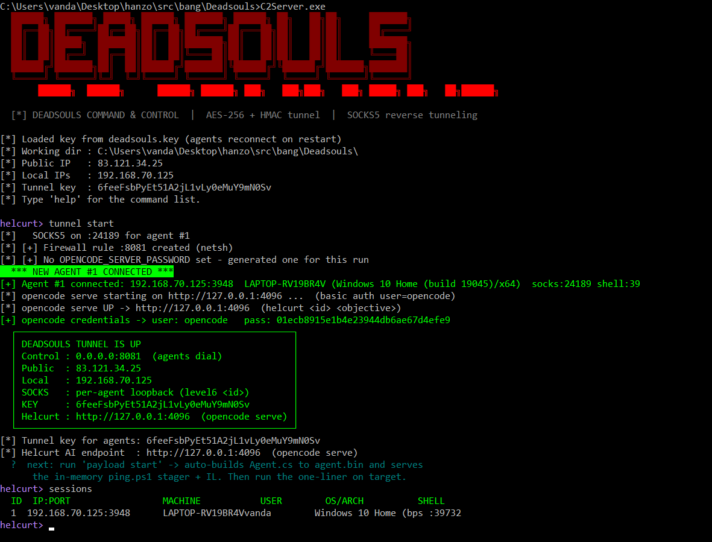

<p align="center">
    
</p>

## Compile

C2Server and DeadsoulsExplorer compile with the plain .NET Framework 4.x compiler (no NuGet):

```shell
# C:\Windows\Microsoft.NET\Framework64\v4.0.30319\csc.exe

# 1. C2 server
C:\Windows\Microsoft.NET\Framework64\v4.0.30319\csc.exe /nologo /target:exe /optimize /out:C2Server.exe C2Server.cs /r:System.dll /r:System.Core.dll

# 2. GUI file-explorer (WinForms)
C:\Windows\Microsoft.NET\Framework64\v4.0.30319\csc.exe /nologo /target:winexe /optimize /out:DeadsoulsExplorer.exe DeadsoulsExplorer.cs /r:System.dll /r:System.Core.dll /r:System.Windows.Forms.dll /r:System.Drawing.dll
```

## Run C2 CLI

```shell
./C2Server.exe --selftest
./C2Server.exe --auto
./C2Server.exe --key verysecrethighentropyrandomkey
```

## Devices:

- Flipper 0 and 1 w/ BFFB (https://justcallmekokollc.com/products/flipper-zero-bffb-v2)

- Flipper 0 and 1 w/ Dual Touch v3 (https://awokdynamics.com/products/dual-touch-v3)

- HackRF Pro + PortaPack H4M Pro | uConsole AIO V2 | BladeRF 2.0 micro xA4 | Wifi PineApple & RubberDockyUsb

## Ideas

> tui webui based engines with tauri wails fynapp with PIAZ (lang & OS) elixir go dotent rs c++ cuda ptx asm for:
    
- live streaming apps over p2p [quic tcp udp mudp kdht mesh, wrtc(pion, rtmp srtp sfu mcu stun turn stls dtls ice), ws], httpWsSse, tcp, udp, grpc, redis, rmq like dorsan, any desk, camera360, discord, meet, instaLive, twitch, youtube with framing fft hmm signal packet reckoning lag lossing routing cycle path detection compressing codec interpolation and kagerou sdk.
    
- socks5 reverse port forwarding tunneling over tcp udp grpc ws sse https like deadsouls, nested RDPs, chisel ngrok caddy and ligolo with encrypted (zkp/entropy->mnemo->seed(pbkdf2)->ed25519Keypair->aes256GsmHMAC) channel.
    
- local packet forwarding (new vpn tunneling protocol) over tcp udp quic grpc ws sse https (act like normal packets) like p2p deeperNetwork device router tailScale torV2Ray using nftables, zkp, chacha20, chachapoly, noise, ipPool, ovpn, l2tp, mikrotik, mDNS, zeroTrust, hub-and-spoke, starLink?, iptables, nat, dns concepts, upnp and all cloudflare tools modules plugins.

